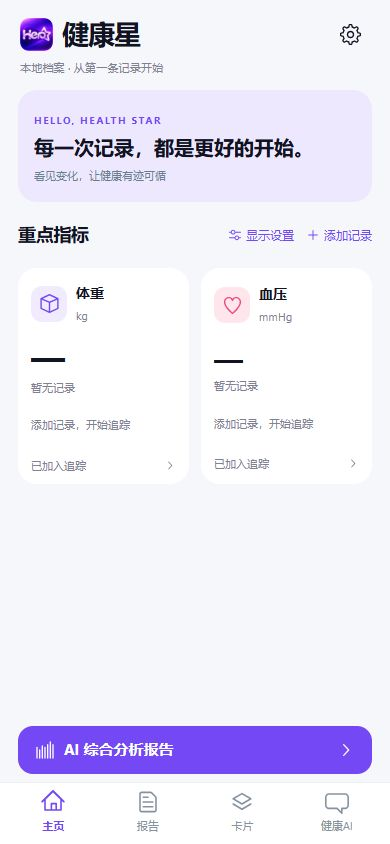
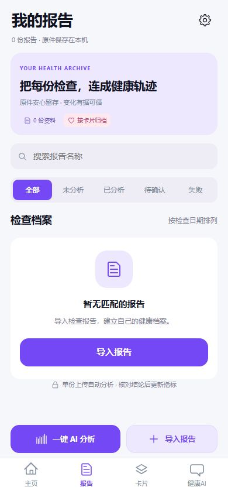
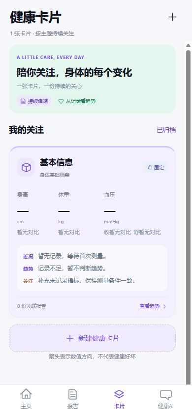
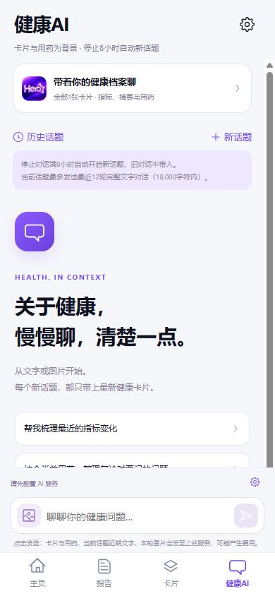

# 健康星 · Health Star

**把分散的健康记录、检查报告和长期变化，整理成自己看得懂的个人健康档案。**

健康星是一款以本机保存为主的 Android 个人健康管理 App。你可以手工记录指标、导入检查报告、按健康卡片整理资料，并在主动配置和使用 AI 服务时辅助提取报告信息、回顾趋势。AI 提取结果需要你核对后，才会进入正式指标记录。

[中文](#中文) · [English](#english)

## 中文

### 它能做什么？

- **记录和追踪：** 手工录入体重、血压等指标，按日期查看历史变化；首页可选择关注的指标。
- **整理检查报告：** 导入图片或 PDF，把原件关联到健康卡片，保留报告与指标的来源关系。
- **按主题管理健康档案：** 用健康卡片汇集相关指标、报告、病情背景和用药记录。
- **按需使用 AI：** 自行配置兼容的 AI 服务地址、模型和 API Key。配置密钥后，选择报告文件会在本机保存原件后自动发送分析；综合分析和健康对话由你主动发起。报告提取值经过人工核对后才更新卡片和趋势。
- **自己掌握数据：** 档案和报告原件保存在 Android 设备的应用私有存储中；可导出密码加密的备份，在另一台设备上整体恢复。AI 密钥不包含在健康备份中。

### 界面截图

以下截图来自本仓库正式 Android 项目 `hero-health-android/` 的 WebView 前端，以 390 × 844 的移动视口在本地预览环境截取。画面使用初始空档案，没有真实健康资料；它们不是旧版设计原型，也不代表实机适配验收。

| 主页 · 指标追踪 | 报告 · 原件归档 | 卡片 · 分类管理 | 健康 AI · 主动对话 |
| :---: | :---: | :---: | :---: |
|  |  |  |  |

### 典型使用流程

1. 在主页添加测量记录，或创建一张健康卡片来关注某个主题。
2. 导入检查报告并选择关联卡片；报告原件先保存在本机。若已配置 AI 密钥，选择文件后会自动向界面显示的服务发送报告及相关卡片资料进行分析，无需再次确认；未配置密钥时只保存原件。
3. 如需其他 AI 辅助，可在设置中配置自己的服务，再主动生成综合分析或发起健康对话。
4. 对照原件核对日期、结论和指标，再确认写入健康档案。
5. 定期导出加密备份。卸载应用或清除应用数据前，请先保存备份文件和密码。

### 数据与使用边界

本项目没有账号系统或自建健康数据服务器。选择报告文件可能触发上述自动分析；其他 AI 请求在你主动点击相应操作时发送。每次发送范围会在界面说明，资料将进入你配置的第三方 AI 服务；服务商可能收费，其数据处理规则由服务商决定。健康星用于整理个人资料和辅助回顾，AI 内容不能替代医生诊断或治疗建议。

生产 Android 项目、构建说明和技术细节见 [`hero-health-android/README.md`](hero-health-android/README.md)。早期原型和设计资料与本仓库的正式 Android 项目分开管理，不能作为当前 App 的功能截图。工程验证与交付规则见 [`engineering/`](engineering/)。

## English

**Keep health measurements, medical reports, and changes over time together in a personal record you can understand.**

Health Star is an Android app centered on local storage. Record measurements manually, import reports, organize them into health cards, and optionally use an AI service you configure to review reports and trends. Extracted values enter your tracked history only after you review and confirm them.

### What can it do?

- **Track measurements:** Add values such as weight and blood pressure, view their history, and choose which metrics appear on the home screen.
- **Organize reports:** Import image or PDF reports, link them to health cards, and keep the original files and source references.
- **Follow topics over time:** Keep related measurements, reports, background notes, and medication records in health cards.
- **Use AI when you choose:** Configure your own compatible endpoint, model, and API key. With a key configured, selecting a report file automatically sends it for analysis after saving the original locally. You start overall summaries and health conversations yourself. Review report findings before adding them to your records and trends.
- **Keep control of your data:** Records and report files live in Android app-private storage. Export a password-encrypted backup for full restoration on another device. The AI API key is excluded from health backups.

### Screenshots

The four screenshots above show the **current Android project's WebView UI** in a local 390 × 844 mobile preview with an empty initial archive. They contain no personal health data. They are not screenshots from an Android device, and they do not demonstrate device-level acceptance.

### Getting started

1. Add a measurement or create a health card.
2. Import a report and associate it with a card. The original is saved locally first. If an AI key is configured, selecting the file then automatically sends the report and relevant card context to the provider shown in the app, without another confirmation. Without a key, import only saves the original.
3. Configure your provider in Settings if needed; start an overall summary or health conversation when you want one.
4. Check extracted dates, findings, and values against the original report before confirming them.
5. Export an encrypted backup before uninstalling the app or clearing its data.

There is no account system or first-party health data server. Selecting a report file can trigger the automatic analysis described above; other AI requests start when you choose the corresponding action. The app states what will be sent to your configured third-party provider; provider charges and data policies may apply. Health Star helps organize information and is not a substitute for medical diagnosis or treatment advice.

The production Android source and build details are in [`hero-health-android/`](hero-health-android/). Earlier prototype and design material is managed separately and does not document the current Android app. Engineering checks and delivery documentation are in [`engineering/`](engineering/).
